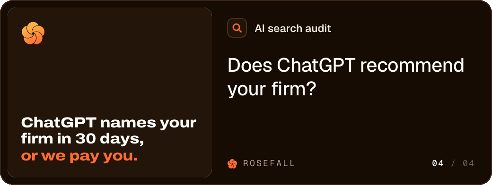

# Animated email signature

A Claude Code skill that makes an animated email signature: a looping GIF card under your name, a still frame for email apps that don't play GIFs, and the HTML to paste into Gmail.



This is the signature on our emails at [Rosefall](https://rosefall.ai). The GIF is 168 KB and loops every 10.85 seconds.

The idea and the layout come from [Daniel Heinen](https://x.com/heinenbros), who made the first one for Graylark and [showed it here](https://x.com/heinenbros/status/2115568642243039495). Credit to him.

## What you need

- [Claude Code](https://claude.com/claude-code)
- Python 3.9 or newer
- ffmpeg and gifsicle
- Somewhere to put the GIF online, such as your website

## Make yours in 5 steps

### 1. Install the skill

```
git clone https://github.com/adam-badar/animated-email-signature ~/.claude/skills/animated-email-signature
pip install playwright
python3 -m playwright install chromium
brew install ffmpeg gifsicle
```

On Ubuntu, the last line is `sudo apt install ffmpeg gifsicle`.

### 2. Run it

In Claude Code, type `/animated-email-signature`. Claude asks for:

- your name, job title and company
- your website
- two colours: the card's background and an accent
- a short label and a headline for the right side of the card
- two to four short lines, one per slide
- a logo, if you want one (square SVG or PNG)

Claude writes `email-signature/signature.json`, makes the GIF and opens it. Ask for changes in plain words, like "shorter second slide" or "use #2F6BFF as the accent".

The files land in `email-signature/output/`:

| File | What it is |
|---|---|
| `signature.gif` | The animated card, 1040x392 pixels, shown at 520x196 |
| `signature-static.png` | The first frame |
| `signature.html` | Your name, title and the linked GIF, for Gmail |
| `preview.html` | Your signature under a sample email, in light and dark |

To skip Claude, copy `examples/simple/signature.json`, edit it and run:

```
python3 ~/.claude/skills/animated-email-signature/scripts/make_signature.py signature.json
```

### 3. Put the GIF online

Gmail loads signature images from a link. Upload `signature.gif` to your website (or any host that gives it a public https address) and open the link in a private window to check it loads.

Then give Claude the link, or run:

```
python3 ~/.claude/skills/animated-email-signature/scripts/make_signature.py signature.json --gif-url https://your-site.com/signature.gif --html-only
```

### 4. Paste it into Gmail

1. Open `output/signature.html` in Chrome.
2. Select all (Cmd+A on a Mac, Ctrl+A on Windows) and copy.
3. In Gmail, click the gear, then See all settings. On the General tab, scroll to Signature.
4. Click Create new, give it a name and paste into the box.
5. Under Signature defaults, choose it for new emails and for replies and forwards.
6. Click Save Changes at the bottom of the page.

### 5. Check it on your phone

Send yourself an email and open it in the Gmail app. The card should animate, and tapping it should open your website. Switch your phone to dark mode and look again.

## The config

The slides come from one of two fields:

- `lines`: a list of short sentences, one slide each. `*stars*` put words in the accent colour and `\n` starts a new line.
- `slides`: each slide with a type. `typing` shows someone typing into an app, `list` shows an answer with up to 3 items and an optional question over it, `statement` is text, and `image` is a screenshot or photo.

`examples/simple/signature.json` uses `lines`. `examples/rosefall/signature.json` uses `slides` and sets every colour by hand. Every field is listed in [SKILL.md](SKILL.md#config-reference).

## Tips

- The loop opens on your last slide. Some Outlook versions on Windows show only a GIF's first frame, so the last slide should be the one that matters most.
- Keep the GIF under 1 MB. Each extra slide adds to it.
- The name and title are HTML text, so they stay readable when an email app blocks images.

## Credits

The idea and layout are from the signature [Daniel Heinen](https://x.com/heinenbros) made for Graylark. The fonts are Geist and Geist Mono by Vercel and Archivo by Omnibus-Type, all under the SIL Open Font License (`fonts/`).

## Licence

MIT. See [LICENSE](LICENSE).
